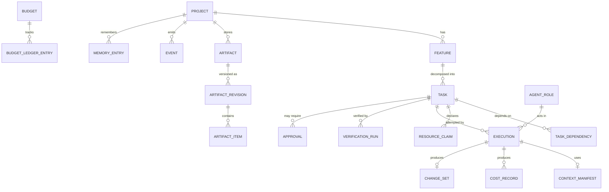

# Domain Model

## 1. Entities



Trace links connect any two of these and are described in [SDD engine](sdd-engine.md#4-traceability).

**Identifiers.** Human-facing artifacts use readable, project-scoped IDs that appear in documents and prompts: `FEAT-0001`, `FR-003`, `NFR-001`, `US-002`, `AC-007`, `ADR-0004`, `PLAN-0001`, `TASK-0012`. Runtime records (executions, events, approvals, cost records) use ULIDs, which sort by creation time.

## 2. Schema

All tables carry `created_at` and `updated_at` (UTC). JSON columns hold structured detail that is not queried relationally. Foreign keys are enforced; the database runs in WAL mode.

### Projects and SDD

| Table | Key columns | Notes |
|-------|-------------|-------|
| `projects` | `id`, `name`, `root_path`, `base_branch`, `is_git`, `execution_policy`, `status` | `root_path` is the workspace boundary |
| `features` | `id`, `project_id`, `key`, `title`, `stage`, `workflow_profile`, `status`, `integration_branch` | `stage` is the SDD stage |
| `artifacts` | `id`, `project_id`, `feature_id?`, `type`, `key`, `path`, `current_revision`, `approved_revision?` | One row per document |
| `artifact_revisions` | `artifact_id`, `version`, `content_hash`, `status`, `author_role`, `source_execution_id?`, `approved_by?`, `approved_at?` | Immutable once approved |
| `artifact_items` | `artifact_id`, `version`, `item_key`, `item_type`, `content_hash`, `text` | Requirement-level units (`FR-`, `AC-`, ...) used for precise impact analysis |
| `trace_links` | `id`, `project_id`, `src_type`, `src_id`, `src_version?`, `dst_type`, `dst_id`, `dst_version?`, `kind`, `status` | `status`: `current`, `stale` |

### Orchestration

| Table | Key columns | Notes |
|-------|-------------|-------|
| `agent_roles` | `id`, `project_id?`, `definition` (JSON), `version`, `enabled` | Effective definition after project overrides |
| `tasks` | `id`, `feature_id`, `key`, `title`, `role_id`, `state`, `resume_state?`, `category`, `priority`, `write_scope` (JSON), `completion_criteria` (JSON), `provider_pin?`, `estimate` (JSON: amount, tokens, duration, basis, sample size), `needs_reassessment`, `reassessment_reason?`, `branch?`, `worktree_path?`, `retry_count` | State machine below. The task's maximum budget is a `budgets` row scoped to it. Actual cost, tokens, duration, provider, and model are read from its executions and cost records, not duplicated here |
| `task_dependencies` | `task_id`, `depends_on_task_id`, `kind` | `kind`: `hard`, `integration` |
| `resource_claims` | `task_id`, `resource_type`, `pattern`, `mode` | Path globs and named resources; `mode`: `read`, `write` |
| `approvals` | `id`, `project_id`, `subject_type`, `subject_id`, `kind`, `status`, `request` (JSON), `decision_by?`, `decision_note?`, `expires_at?` | Survives restart |
| `messages` | `id`, `project_id`, `task_id?`, `sender_role`, `recipient_role`, `type`, `context_refs` (JSON), `payload` (JSON) | Structured agent messages |

### Execution and cost

| Table | Key columns | Notes |
|-------|-------------|-------|
| `executions` | `id`, `task_id?`, `feature_id?`, `role_id`, `kind`, `provider`, `model?`, `tier`, `status`, `attempt`, `retry_of?`, `permission_profile`, `envelope` (JSON), `provider_session_id?`, `runner_pid?`, `runner_started_at?`, `dir_path`, `log_offset`, `error_class?`, `error_detail?`, `started_at?`, `ended_at?` | `kind`: `authoring`, `implementation`, `review`, `repair` |
| `context_manifests` | `execution_id`, `fingerprint`, `items` (JSON), `estimated_tokens`, `template_id`, `template_version` | What the agent was given, and why |
| `change_sets` | `id`, `task_id`, `execution_id`, `base_commit`, `head_commit`, `files` (JSON), `scope_violations` (JSON) | Links tasks to code |
| `verification_runs` | `id`, `task_id?`, `feature_id?`, `kind`, `command`, `input_fingerprint`, `status`, `reused_from?`, `results` (JSON), `duration_ms` | `kind`: `lint`, `typecheck`, `unit`, `integration`, `e2e`, `acceptance` |
| `ac_verifications` | `ac_item_key`, `feature_id`, `method`, `status`, `evidence_ref?`, `waived_by?` | One row per acceptance criterion |
| `cost_records` | `id`, `execution_id`, `provider`, `model?`, `measurement`, `billing_basis`, `amount_usd?`, `input_tokens?`, `output_tokens?`, `cache_read_tokens?`, `cache_write_tokens?`, `duration_ms`, `is_retry`, `succeeded`, `source`, `raw` (JSON) | `measurement`: `provider_reported`, `estimated`, `unknown` |
| `budgets` | `id`, `scope_type`, `scope_id`, `meter`, `limit`, `period`, `thresholds` (JSON), `on_exceed` | `meter`: `usd`, `tokens`, `executions`, `duration_s` |
| `budget_ledger` | `id`, `budget_id`, `execution_id`, `entry_type`, `amount`, `measurement` | `entry_type`: `reserve`, `settle`, `release` |
| `provider_status` | `provider`, `binary_path`, `version`, `health` (JSON), `capabilities` (JSON), `checked_at` | Cached by binary path and version |

### Events, context, memory

| Table | Key columns | Notes |
|-------|-------------|-------|
| `events` | `seq` (autoincrement), `id`, `type`, `ts`, `project_id?`, `feature_id?`, `task_id?`, `execution_id?`, `role_id?`, `provider?`, `severity`, `correlation_id`, `causation_id?`, `payload` (JSON) | Append-only; indexed on every filter column |
| `audit_log` | `id`, `ts`, `actor`, `action`, `subject`, `detail` (JSON), `outcome` | Human decisions, policy decisions, engine-run commands |
| `file_index` | `project_id`, `path`, `content_hash`, `language`, `size`, `imports` (JSON) | Refreshed incrementally by hash |
| `symbol_index` | `project_id`, `path`, `name`, `kind`, `start_line`, `end_line`, `file_hash` | Phase 7 |
| `search_fts` | FTS5 over artifact items, memory entries, symbol names | Keyword retrieval |
| `memory_entries` | `id`, `project_id`, `layer`, `scope_id?`, `kind`, `text`, `provenance`, `status`, `source_execution_id?`, `supersedes?` | `layer`: `project`, `feature`, `task`, `agent` |
| `cache_entries` | `kind`, `key`, `input_fingerprint`, `value_ref`, `created_at` | Reuse guarded by fingerprint |

## 3. Task state machine

The engine applies transitions through a single function that rejects anything not in this table and emits one event per transition.

| From | To | Trigger |
|------|----|---------|
| `BACKLOG` | `READY` | Dependencies completed and originating artifacts approved |
| `READY` | `ASSIGNED` | Scheduler routes the task and reserves budget |
| `READY` | `BACKLOG` | A dependency is reopened |
| `ASSIGNED` | `IN_PROGRESS` | Execution starts |
| `ASSIGNED` | `READY` | Unassigned before start (pre-flight failed transiently) |
| `IN_PROGRESS` | `REVIEW` | Execution succeeded, scope check passed, fast gate passed |
| `IN_PROGRESS` | `FAILED` | Retry policy exhausted |
| `REVIEW` | `TESTING` | Review passed (or not required for the category) |
| `REVIEW` | `IN_PROGRESS` | Changes requested |
| `TESTING` | `COMPLETED` | Integrated, acceptance checks passed, linked criteria verified or waived |
| `TESTING` | `IN_PROGRESS` | Acceptance checks failed |
| `FAILED` | `READY` | Human authorizes another attempt |
| `BLOCKED` | `READY` | Blocker resolved |
| `NEEDS_APPROVAL` | `resume_state` | Approved |
| `NEEDS_APPROVAL` | `BLOCKED` or `CANCELLED` | Rejected |
| `PAUSED` | `resume_state` | Resumed |
| `ASSIGNED`, `IN_PROGRESS`, `REVIEW`, `TESTING` | `BLOCKED` | Dependency, conflict, or provider unavailable |
| `ASSIGNED`, `IN_PROGRESS`, `REVIEW`, `TESTING` | `NEEDS_APPROVAL` | Budget, permission, or high-impact gate; stores `resume_state` |
| `ASSIGNED`, `IN_PROGRESS`, `REVIEW`, `TESTING` | `PAUSED` | User pauses; stores `resume_state` |
| Any non-terminal | `CANCELLED` | User cancels |

`COMPLETED` and `CANCELLED` are terminal. A completed task affected by a later specification change is not reopened: it is flagged `needs_reassessment`, and any rework becomes a new task, so history stays intact.

How the brief's `REVIEW -> TESTING` order is reconciled with running cheap checks first:

- **Fast gate** (inside `IN_PROGRESS`): lint, typecheck, and the tests targeted at the change. Run by the engine, no AI. A task that fails here goes back to the implementer with the failure digest, without paying for a review.
- **`REVIEW`**: static checks plus, depending on category, an AI review execution.
- **`TESTING`**: the task branch is integrated into the feature branch and the acceptance checks run on the integrated result.

## 4. Execution state machine

```text
PENDING -> STARTING -> RUNNING -> SUCCEEDED
                          |-----> FAILED        (error_class set)
                          |-----> CANCELLED
                          |-----> TIMED_OUT
                          '-----> INTERRUPTED   (engine lost it; decided by recovery)
```

An execution is immutable once it reaches a final status. A retry is a new execution with `retry_of` set and `attempt` incremented, so retry cost is recorded separately.

## 5. Feature stage machine

```text
DISCOVERY -> SPECIFICATION -> ARCHITECTURE -> PLANNING -> IMPLEMENTATION
          -> VERIFICATION -> REVIEW -> DELIVERY -> DONE
```

Stage gates are data: each stage lists the artifacts that must be approved and the checks that must pass before the next stage opens. A workflow profile can merge or skip stages but cannot skip a gate that its remaining stages declare. Moving backward (for example, a specification change during implementation) is allowed and triggers impact analysis.

## 6. Artifact revision states

`draft -> in_review -> approved -> superseded`, plus `rejected`. Only `approved` revisions are given to agents as authoritative context. Exactly one revision per artifact is approved at a time.

## 7. Approval states

`pending -> approved | rejected | expired | cancelled`. An approval records who decided, when, and the exact request they saw (a snapshot, not a reference), so the audit trail stays accurate if the subject changes later.
