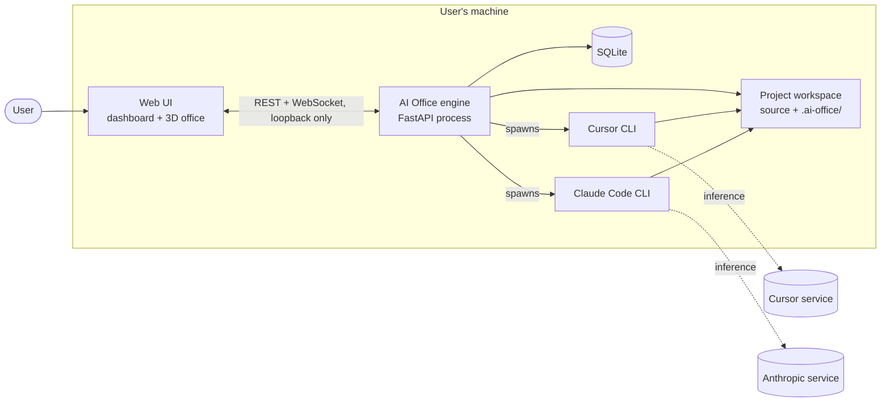
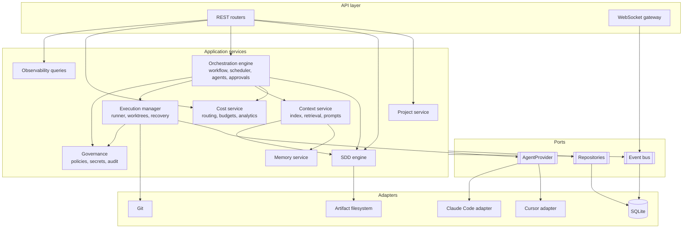
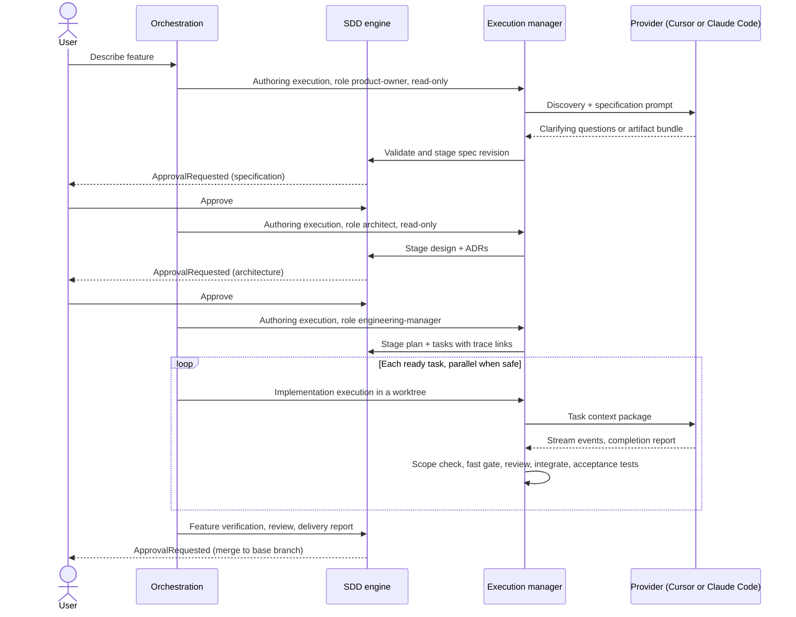
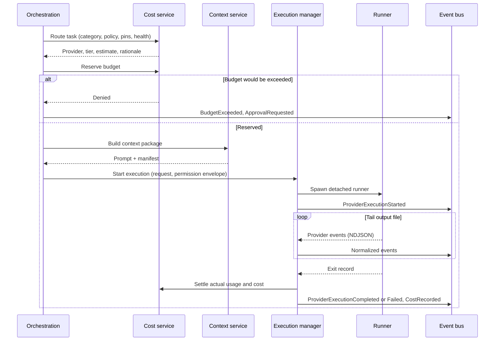

# System Architecture

## 1. Style

A **local modular monolith** with hexagonal boundaries: one backend process, one SQLite database, one frontend bundle. Modules communicate through typed service interfaces and an in-process event bus. There is no message broker, no microservice split, and no cloud component. Rationale in [ADR-0001](decisions/ADR-0001-local-modular-monolith.md).

## 2. System context



The application, its state, and all orchestration are local. Model inference is not: both CLIs call their vendors' services under the user's own authentication. The UI states this plainly.

## 3. Components



| Module | Owns | Must not |
|--------|------|----------|
| `domain` | Entities, value objects, state machines, event types. Pure, no I/O | Import any other module |
| `projects` | Project registration, import, the `.ai-office/` scaffold | Parse or version artifacts |
| `sdd` | Artifact repository, revisions, traceability graph, impact analysis, stage gates | Start executions |
| `orchestration` | Workflow driver, scheduler, agent registry, approvals, agent messages | Import a concrete provider adapter or build CLI arguments |
| `cost` | Classification, routing, budgets and ledger, estimation, analytics | Call providers |
| `context` | File and symbol index, retrieval, context manifests, prompt templates | Write artifacts |
| `memory` | Memory entries and proposals | Modify approved artifacts |
| `execution` | Execution lifecycle, runner processes, worktrees, verification commands, recovery | Decide what to run |
| `providers` | `AgentProvider` contract, Cursor adapter, Claude Code adapter | Know about tasks, features, or budgets |
| `governance` | Workspace boundary, command policy, permission envelopes, secret handling, audit | - |
| `events` | Envelope, bus, persistent store, replay | - |
| `persistence` | Engine setup, migrations, repositories, unit of work | Contain business rules |
| `api` | HTTP and WebSocket transport, request and response schemas | Contain business rules |

**Dependency rule.** `domain` depends on nothing. Application services depend on `domain` and on ports. Adapters implement ports. `orchestration` sees providers only through `providers.base`. This is enforced in CI with an import-linter contract, so "the engine contains no provider-specific logic" is a failing build rather than a convention.

## 4. Process model

| Process | Count | Lifetime | Notes |
|---------|-------|----------|-------|
| Engine (uvicorn, one worker) | 1 | App session | Single writer to SQLite; runs the scheduler loop as an asyncio task |
| Execution runner | 1 per running execution | One execution | Detached from the engine (own session and process group). Launches the CLI, writes stdout and stderr to files, enforces the timeout, records the exit code. Survives an engine crash. See [ADR-0006](decisions/ADR-0006-detached-execution-runner.md) |
| Provider CLI | 1 per execution | One execution | Child of the runner; working directory is the task's worktree |
| Engine command | As needed | One command | Tests, linters, git. Run by the engine under command policy, never through an AI session |

One worker is deliberate: the scheduler, budget ledger, and state machines assume a single writer, and one local user does not need more.

## 5. Runtime flows

### 5.1 From idea to delivery



The number of executions shown is the `full` workflow profile. Smaller changes use lighter profiles ([SDD engine](design/sdd-engine.md#6-workflow-profiles)).

### 5.2 One execution



## 6. Technology stack

| Layer | Choice | Reason |
|-------|--------|--------|
| Backend language | Python 3.12 | Brief's preference; strong asyncio subprocess support. No evaluation result justified another stack |
| Web framework | FastAPI + uvicorn | REST, WebSockets, and OpenAPI in one |
| Validation | Pydantic v2 | Domain schemas, event payloads, artifact front matter |
| Database | SQLite (WAL) via SQLAlchemy 2.x + aiosqlite | Local, transactional, FTS5 built in |
| Migrations | Alembic | Versioned schema from the first table |
| Packaging | uv | Lockfile, fast, already installed |
| Code structure | tree-sitter (Phase 7) | Symbol outlines without any model |
| Frontend | React, TypeScript, Vite, Tailwind CSS, Zustand | As specified |
| Server state | TanStack Query | Snapshots and cache invalidation; Zustand holds live event-derived state |
| API types | Generated from OpenAPI | One source of truth for request and response types |
| 3D | three.js via React Three Fiber and drei | As specified; loaded lazily |
| Tests | pytest, Vitest, Playwright | Unit, integration, and UI |
| Quality | ruff, mypy (strict), eslint, tsc, import-linter | Type safety and boundary enforcement |

## 7. Repository layout

```text
ai-engineering-office/
├── README.md
├── AGENTS.md                     # working rules for AI sessions building this project
├── .ai-office/                   # this project's own SDD artifacts, including this design
├── backend/
│   ├── pyproject.toml
│   ├── alembic/                  # migrations
│   ├── src/aio/
│   │   ├── domain/               # pure models, state machines, events
│   │   ├── config/               # layered settings
│   │   ├── persistence/          # engine, unit of work, repositories
│   │   ├── events/               # bus, store, replay
│   │   ├── governance/           # boundary, policies, envelopes, audit
│   │   ├── projects/             # create, import, scaffold
│   │   ├── sdd/                  # artifacts, revisions, trace, impact
│   │   ├── orchestration/        # workflow, scheduler, agents, approvals
│   │   ├── execution/            # manager, runner, worktrees, verification
│   │   ├── providers/            # base.py, cursor.py, claude_code.py
│   │   ├── cost/                 # classify, route, budgets, analytics
│   │   ├── context/              # index, retrieval, manifests
│   │   ├── memory/
│   │   ├── api/                  # routers, websocket, schemas
│   │   ├── resources/            # built-in roles, prompt templates, artifact templates
│   │   └── main.py
│   └── tests/
│       ├── unit/ integration/ contract/
│       └── fixtures/provider-streams/   # recorded NDJSON per CLI version
├── frontend/
│   ├── package.json
│   └── src/
│       ├── api/                  # generated client, websocket client
│       ├── store/                # zustand slices, event reducer
│       ├── features/             # board, specs, executions, costs, approvals, events
│       ├── office3d/             # lazy chunk
│       └── app/                  # shell, routing, theme
└── scripts/                      # dev, start, stop
```

## 8. Data locations

| Data | Location | In the project's git? |
|------|----------|-----------------------|
| Engineering artifacts | `<project>/.ai-office/` | Yes, the user's choice |
| Application database | `<app data>/ai-office.db` | No |
| Execution directories (prompt, raw output, exit record) | `<app data>/executions/<execution id>/` | No |
| Task worktrees | `<app data>/worktrees/<project>/<task>/` | No (separate checkouts) |
| Global configuration | `<app data>/config.toml` | No |
| Secrets, if any | macOS Keychain | No |

`<app data>` is `~/Library/Application Support/ai-office/`. macOS is the only supported platform. One database serves all projects, so cost and history can be viewed across them. Raw execution output stays out of the project; compact summaries are exported to `.ai-office/execution-history/`.

## 9. Configuration

Resolved in order, later overriding earlier: built-in defaults, global `config.toml`, project `.ai-office/project.yaml`, feature overrides, per-task overrides. The resolved value and its source layer are visible in the UI, so the user can always see why a provider, budget, or policy applied.

## 10. Local deployment

- `scripts/start` launches the engine, which serves the built frontend on a configurable loopback port and opens the browser. `scripts/stop` shuts down gracefully.
- `scripts/dev` runs uvicorn with reload and the Vite dev server.
- On graceful shutdown the engine does not kill running executions by default. They finish under their runners and are settled on next start. The user can choose "stop all" instead.
- Docker Compose is not provided for the engine ([requirements, A7](../specifications/discovery-notes.md#3-ambiguities-and-resolutions)).
